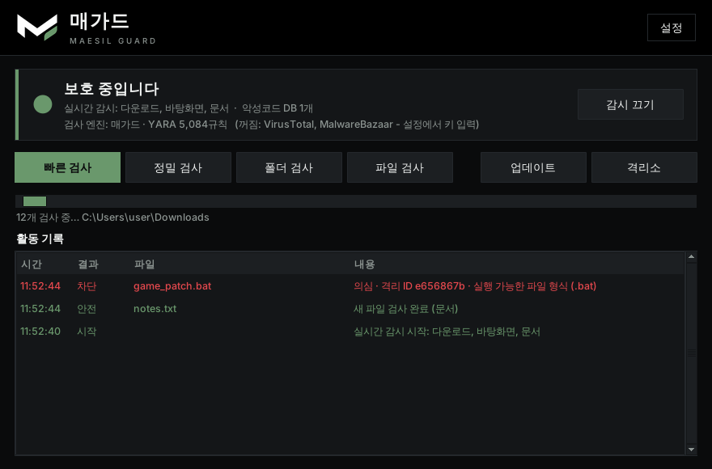

<p align="center">
  
</p>

<h1 align="center">매가드 (MaeGuard)</h1>

<p align="center">
  <b>실시간 다운로드 감시 보안 도구</b><br>
  수상한 파일을 찾아내고, 차단할지 물어봅니다. Windows Defender와 함께 사용하세요.
</p>

<p align="center">
  
</p>

> Windows Defender를 켜 둔 상태에서 함께 쓰는 것을 권장합니다.
> 알려진 악성코드와 흔한 수법은 잘 잡지만, 처음 보는 신종이나 실행 후에 드러나는 공격까지 모두 막을 수 있는 보안 프로그램은 없습니다.

## 설치

[Releases](../../releases) 에서 `MaeGuard_Setup_x.y.z.exe` 를 받아 실행하세요.
관리자 권한 없이 설치되고, 설치 후에는 시계 옆 트레이에서 백그라운드로 동작합니다.

아직 코드 서명이 없어서 처음 실행할 때 "Windows의 PC 보호" 창이 뜰 수 있습니다. **추가 정보 → 실행** 을 누르면 됩니다.

## 기능

- 실시간 감시: 다운로드, 바탕화면, 문서, 시작프로그램 폴더 (하위 폴더 포함, OneDrive 포함)
- 의심 파일 발견 시 이유를 보여주고 차단(격리)할지 물어봄
- 격리소: 차단한 파일은 실행할 수 없는 상태로 보관, 복원 · 영구 삭제 가능
- 빠른 검사 / 정밀 검사 / 폴더 · 파일 검사
- 트레이 상주, 윈도우 시작 시 자동 실행

## 검사 방식

| 엔진 | 내용 | 설정 |
|---|---|---|
| 매가드 자체 | 위장 파일(`.pdf.exe` 등), 난독화된 스크립트, 디펜더 끄기, 랜섬웨어 명령, 디스코드 · 로블록스 · 스팀 계정 탈취 코드, 오피스 매크로, PDF 스크립트, 압축 속 압축(3단계) | 없음 |
| Windows Defender | 마이크로소프트 백신 엔진으로 한 번 더 검사 | 없음 |
| YARA | [YARA Forge](https://github.com/YARAHQ/yara-forge) core 규칙 약 5천 개, 주 1회 자동 갱신 | 없음 |
| MalwareBazaar | 최근 48시간 악성코드 해시 목록 | [abuse.ch](https://auth.abuse.ch) 무료 Auth-Key |
| VirusTotal | 70여 개 백신의 판정 조회 (해시만 전송) | [VirusTotal](https://www.virustotal.com) 무료 API 키 |

키는 프로그램의 **설정** 에서 입력합니다. 어디로 무엇을 보내는지는 [PRIVACY.md](PRIVACY.md) 에 정리되어 있습니다.

## 직접 빌드

Windows + Python 3.12 에서 `build.bat` 실행 → `dist/` 에 `MaeGuard.exe` 와 설치 파일이 생성됩니다.
GitHub 에서 릴리스를 Publish 하면 Actions 가 자동으로 빌드해서 설치 파일을 릴리스에 올립니다.

```
python tests/test_maeguard.py
```

테스트는 실제 악성코드 없이 EICAR 표준 테스트 문자열과 직접 만든 무해한 샘플만 사용합니다.

## 구조

```
maeguard.py           검사 로직, 폴더 감시, 격리, CLI
maeguard_engines.py   Defender / VirusTotal / YARA 연동
maeguard_gui.py       GUI, 트레이, 자동 실행
installer.nsi         설치 파일 (NSIS)
tests/                자동 테스트
```

## 이용 조건 관련

VirusTotal 무료 API와 abuse.ch 데이터는 비상업적 용도로만 쓸 수 있습니다.
YARA 규칙은 저장소에 포함하지 않고 사용자 PC가 직접 내려받으며, 각 규칙의 라이선스는 규칙 파일 안에 표시되어 있습니다.

## 코드 서명

[SignPath Foundation](https://signpath.org/) 오픈소스 무료 코드 서명을 신청 중입니다. 서명 정책은 [CODE_SIGNING_POLICY.md](CODE_SIGNING_POLICY.md) 를 참고하세요.

## 라이선스

[MIT](LICENSE)
